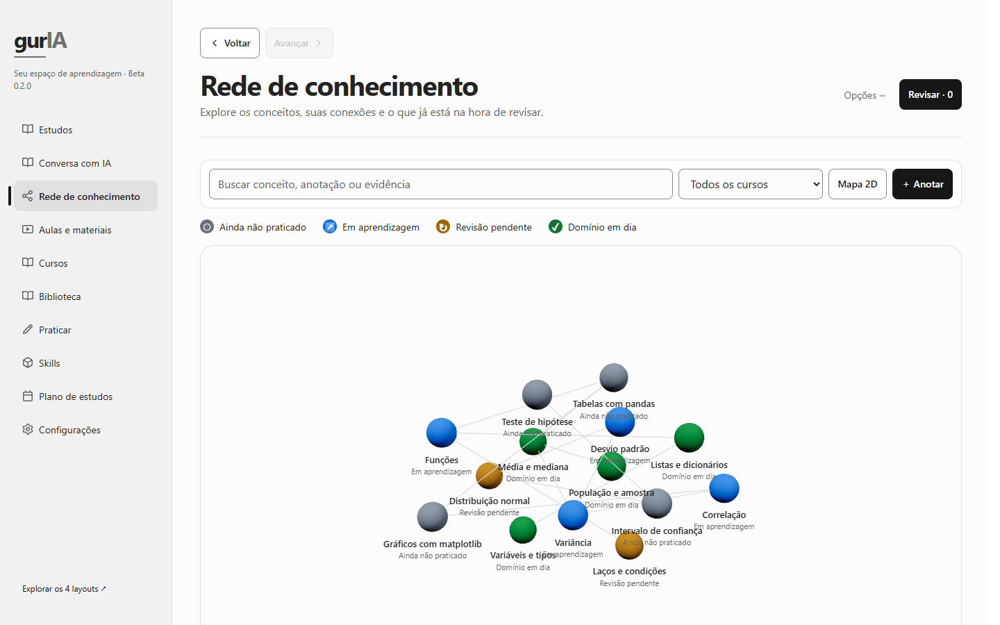
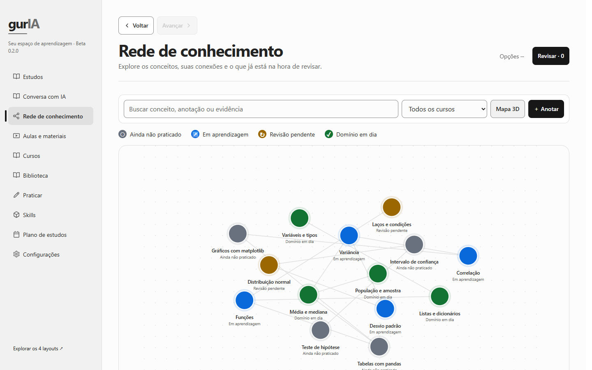
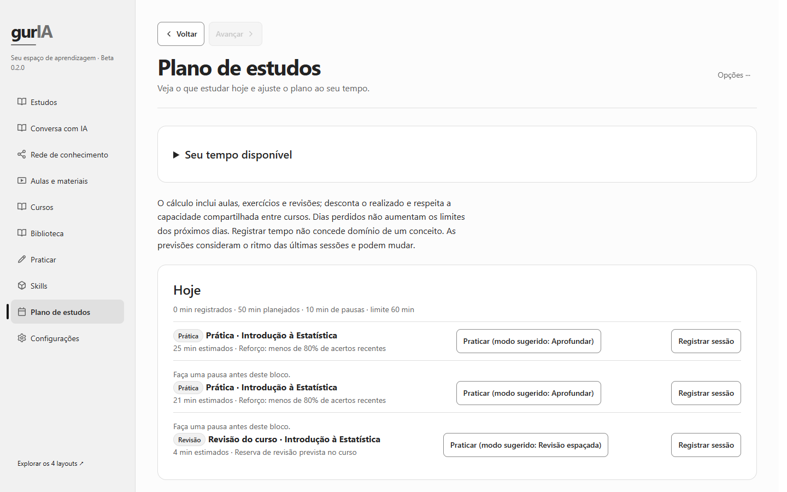
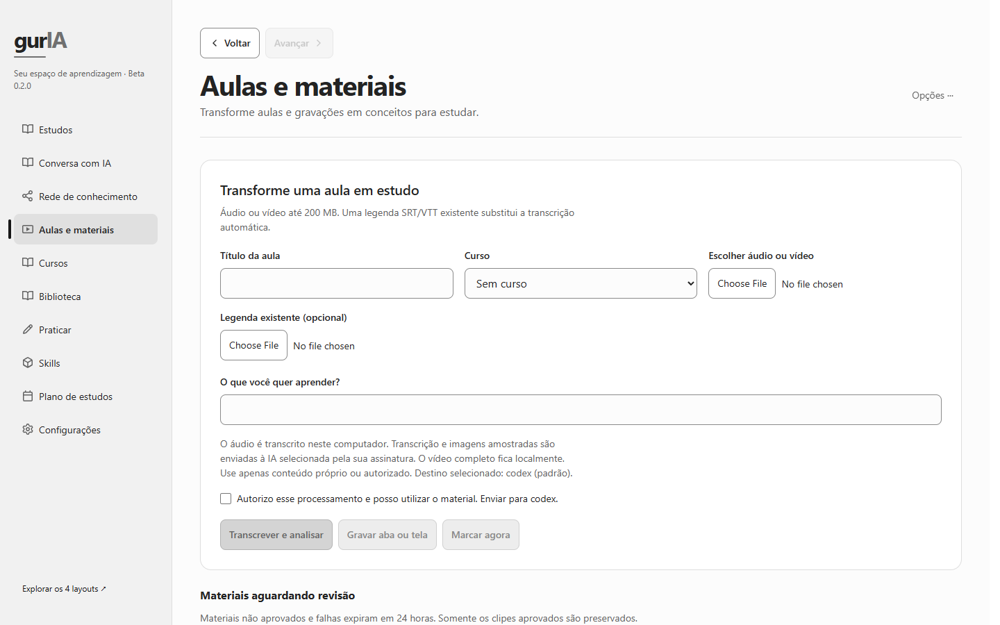
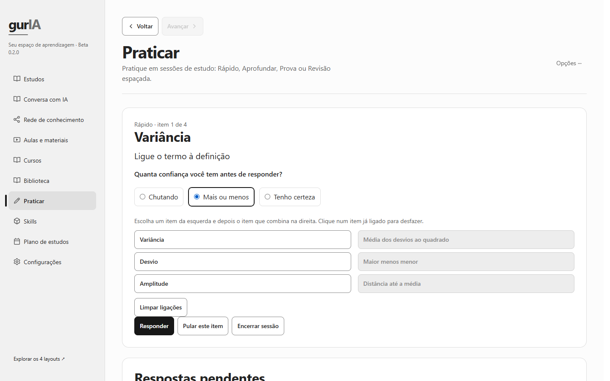
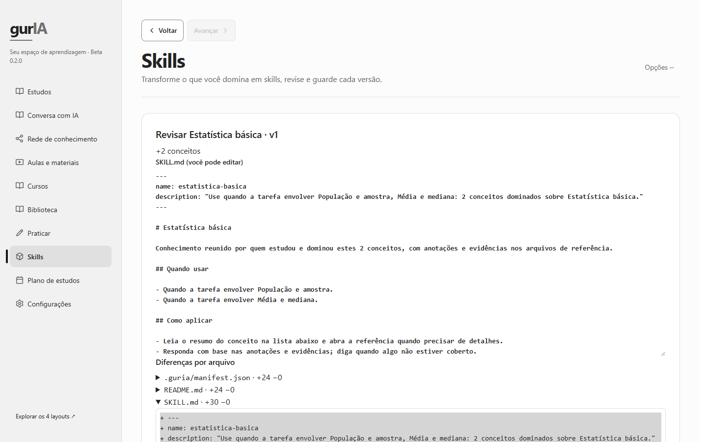
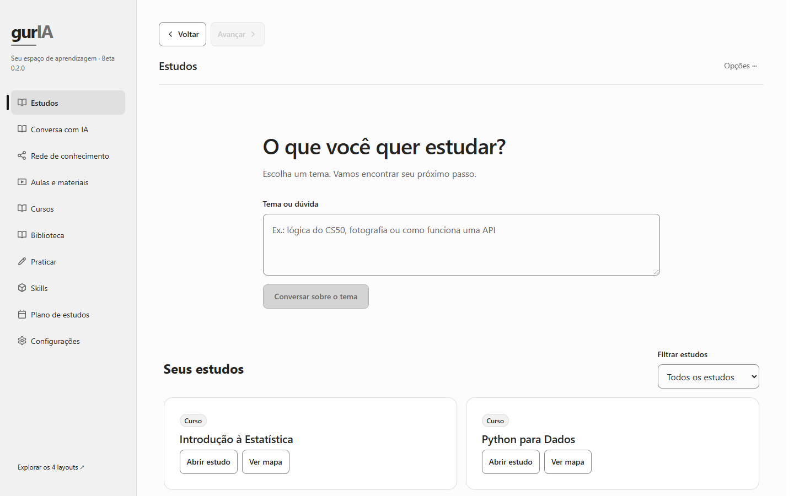
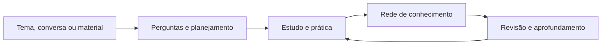

<p align="center">
  
</p>

<h1 align="center">Aprender é conectar ideias.</h1>
<p align="center">Um espaço pessoal para estudar, praticar e acompanhar o que você aprende.</p>
<p align="center"><strong>Beta 0.2.0</strong> · Português brasileiro · Windows</p>

---

A **gurIA** transforma temas, aulas e conversas em caminhos de estudo. Você escolhe o que quer aprender; o aplicativo organiza as próximas etapas, ajuda a praticar e mostra as conexões entre conceitos numa rede que cresce com o que você domina.

> **Projeto em desenvolvimento.** Roda localmente no seu computador, mas as respostas de IA são processadas pelo serviço que você escolher (Codex ou Claude, com a sua assinatura). Veja [IA e custos](#ia-e-custos).

## Como é

| | |
|---|---|
|  |  |
| **Rede 3D.** Cada esfera é um conceito; a cor mostra o estado de aprendizagem. | **Rede 2D.** A mesma rede, em modo plano. |
|  |  |
| **Plano de estudos.** Aulas, práticas e revisões distribuídas pelo seu tempo, com o modo de estudo sugerido. | **Aulas e materiais.** Transforme áudio, vídeo ou legendas em conceitos. |
|  |  |
| **Praticar.** Quatro modos de estudo e quatro tipos de exercício, com confiança marcada antes de responder. | **Skills.** Transforme o que você domina em uma skill, revise o diff e guarde cada versão em um commit. |



*Imagens geradas com dados fictícios.*

## O que você encontra

- **Estudos guiados:** escolha um tema, responda perguntas sobre seus objetivos e revise o planejamento antes de salvar.
- **Rede de conhecimento:** explore conceitos e conexões em 2D e 3D, com cores para os estados: ainda não praticado, em aprendizagem, revisão pendente e domínio em dia.
- **Modos de estudo e exercícios:** Rápido, Aprofundar, Prova e Revisão espaçada, com escolha, ligar, escrita e desenho. Você marca sua confiança antes de responder; a correção por IA só acontece quando você envia e, se a cota acabar, a resposta fica pendente para reenviar depois. O domínio exige duas demonstrações sem ajuda, com pelo menos 3 dias de intervalo.
- **Planejamento adaptativo:** organize o tempo disponível e acompanhe aulas, exercícios e revisões.
- **Materiais:** trabalhe com áudio, vídeo ou legendas; a transcrição pode ser feita localmente.
- **Importar curso:** traga um curso que você já tem (pasta, zip como os do MIT OpenCourseWare, PDFs ou uma playlist do YouTube com legendas). A gurIA monta o roteiro sem IA, processa cada aula só quando você pedir e gera resumos, exercícios e uma apostila em português. Veja [docs/guia/estudos.md](docs/guia/estudos.md#importar-um-curso).
- **Conversa com IA:** converse sobre uma ideia e leve o tema sugerido para a área de estudos.
- **Skills:** transforme os conceitos que você domina em skills (`SKILL.md`, `README.md` e referências), revise o diff, guarde cada versão em um commit e publique no GitHub só quando você confirmar. Veja [docs/guia/skills.md](docs/guia/skills.md).

Detalhes e limites em [docs/guia/estudos.md](docs/guia/estudos.md) (modos, exercícios, correção por IA e domínio) e [docs/guia/skills.md](docs/guia/skills.md).

## Como funciona



Você revisa o conteúdo antes de salvar. Seus dados de estudo ficam no banco local.

## IA e custos

A gurIA usa **Codex** ou **Claude** com contas autenticadas e configuração explícita. Ela verifica limites antes de gerar, bloqueia uso extra e **nunca troca de serviço sozinha**. A cota incluída na sua assinatura pode ser consumida. Chaves de API ficam fora. Detalhes em [docs/guia/estudos.md](docs/guia/estudos.md#ia-e-custo).

## Instalação

Resumo (passo a passo completo em [docs/guia/instalacao.md](docs/guia/instalacao.md)):

```powershell
git clone https://github.com/lgsMangolt/gurIA.git
cd "gurIA"
npm ci
Copy-Item .env.example .env.local
npm run db:up
npm run dev
```

Requisitos: Windows, Node.js 22.19+ (com npm) e Docker Desktop aberto. Para importar cursos com PDF, DOCX ou PPTX, também Python 3.12 e o conversor MarkItDown ([como instalar](docs/guia/instalacao.md#importar-cursos-python-e-markitdown)). Depois abra <http://127.0.0.1:3033/study>. **Não compartilhe `.env.local` nem credenciais.**

## Testes

```powershell
npm test
npm run typecheck
npm run build
```

Para ver o app com dados fictícios, sem tocar nos seus: `npm run demo` (banco 5441, app 3034). Testes que chamam IA são opcionais e consomem cota. Use dados sintéticos e um banco isolado.

## Estado e próximos passos

A gurIA é um beta pessoal: sem instalador independente e só para Windows. Já tem os quatro modos de estudo, os quatro tipos de exercício com correção por IA e a geração de skills.

A gurIA **não depende mais do OpenMAIC**: o código herdado saiu e a instalação é própria (veja [o resultado da fase 4](docs/superpowers/notes/2026-11-20-fase-4-resultado.md)). Quem vinha da versão anterior encontra no banco algumas **tabelas antigas** do OpenMAIC (`document_*`, `stage_meta`, `runtime_*` e outras) que a gurIA não usa mais. Elas ficaram de propósito, como rede de segurança, e podem ser apagadas à mão depois de um backup, se você quiser.

O que vem a seguir: dublar as aulas no seu computador (com o Voicebox) e, depois, uma assinatura de dublagem.

## Créditos e licença

A gurIA nasceu a partir do [OpenMAIC](https://github.com/THU-MAIC/OpenMAIC) (THU-MAIC e colaboradores), distribuído sob a licença MIT. Os avisos de copyright e a licença estão em [LICENSE](LICENSE); os poucos arquivos adaptados dele estão listados em [THIRD_PARTY_NOTICES.md](THIRD_PARTY_NOTICES.md).
