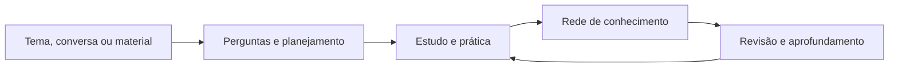

<p align="center">
  
</p>

<h1 align="center">Aprender é conectar ideias.</h1>
<p align="center">Um espaço pessoal para estudar, praticar e acompanhar o que você aprende.</p>
<p align="center"><strong>Beta 0.2.0</strong> · Português brasileiro · Windows · Baseado no OpenMAIC</p>

---

A **gurIA** transforma temas, aulas e conversas em caminhos de estudo. Você escolhe o que quer aprender; o aplicativo ajuda a organizar as próximas etapas, praticar e visualizar conexões entre conceitos.

> **Projeto em desenvolvimento.** A edição pessoal funciona localmente, mas as respostas de IA são processadas pelo serviço escolhido. Algumas integrações estão em teste e ainda não estão ativas no aplicativo.

## O que você encontra

- **Estudos guiados:** escolha um tema, responda perguntas sobre seus objetivos e revise um planejamento antes de salvar.
- **Rede de conhecimento:** explore conceitos e conexões em visualizações 2D e 3D, com cores para acompanhar os estados de aprendizagem.
- **Prática e revisão:** responda questões dentro da gurIA e acompanhe seus resultados na rede.
- **Planejamento adaptativo:** organize o tempo disponível e acompanhe aulas, exercícios e revisões.
- **Materiais:** trabalhe com áudio, vídeo ou legendas; a transcrição pode ser feita localmente com ferramentas instaladas.
- **Conversa com IA:** converse sobre uma ideia e leve um tema sugerido para a área de estudos. O histórico dessa conversa é temporário na aba do navegador; o fluxo ainda precisa de teste completo na interface.

## Como funciona



Você revisa o conteúdo antes de salvar. Seus dados de estudo ficam no banco local; pedidos de IA enviados ao Codex ou ao Claude são processados pelo provedor escolhido.

## IA e custos

A edição pessoal foi desenvolvida para usar **Codex** ou **Claude** com contas autenticadas e configuração explícita. A implementação verifica limites e contém bloqueios para evitar uso extra, sem trocar automaticamente de provedor. Disponibilidade, modelos e limites dependem da sua conta. A cota incluída na assinatura pode ser consumida.

A integração da **área Pro com Codex** passou por testes isolados, mas permanece desativada no atalho: a inicialização integrada apresentou alto consumo de memória e precisa de correção antes de ser liberada. Imagens, anexos e serviços de mídia pagos não fazem parte dessa integração experimental.

## Executar em desenvolvimento

### Requisitos

- Windows, Node.js **22.19 ou superior** e pnpm **10 ou superior**.
- Docker Desktop com PostgreSQL disponível.
- Uma instalação e autenticação compatíveis do Codex ou Claude para recursos de IA.
- Para transcrição local, ferramentas e modelos de áudio instalados e configurados separadamente.

### Instalação

```powershell
pnpm install
Copy-Item .env.example .env.local
```

Configure o banco e a identidade local em `.env.local` antes de iniciar. **Não compartilhe esse arquivo nem credenciais.** A instalação pessoal existente usa PostgreSQL local na porta 5440 e o endereço `http://127.0.0.1:3033/study`. Essa configuração pode precisar ser adaptada para uma instalação nova; os scripts de desktop e de transcrição ainda refletem o ambiente Windows em que o beta foi desenvolvido.

```powershell
pnpm db:up
pnpm dev
```

O comando padrão do OpenMAIC pode usar outra porta e configuração de banco. Consulte [ESTUDOS.md](ESTUDOS.md) e confira as variáveis locais antes de utilizar seus dados. O projeto ainda não oferece um instalador independente reproduzível para todos os computadores.

## Testes

```powershell
node node_modules/vitest/vitest.mjs run --config vitest.study.config.ts
node node_modules/typescript/bin/tsc -p tsconfig.study.json --noEmit
```

Alguns testes de integração que chamam IA são opcionais e consomem cota da assinatura. Use dados sintéticos e um banco isolado; não execute scripts de teste contra dados pessoais sem verificar seus efeitos.

## Estado do projeto

A gurIA é um beta pessoal. O histórico da conversa na aba de IA é temporário; a integração Pro não está liberada; e a última versão da aba de conversa ainda precisa de validação completa na interface com uma IA real. Os recursos descritos podem exigir configuração e disponibilidade local.

## Créditos e licença

A gurIA é construída sobre o [OpenMAIC](https://github.com/THU-MAIC/OpenMAIC), desenvolvido por THU-MAIC e colaboradores. A documentação original está preservada em [README.openmaic.md](README.openmaic.md). O código original é distribuído sob a [licença MIT](LICENSE); seus avisos de copyright e licença são mantidos neste repositório.
